slowLandscapeLODGen is a TES 4: Oblivion (and Nehrim) tool that generates landscape LOD: the terrain meshes, color textures and normal maps you see beyond the loaded cells. (Not to be confused with object LOD, the things standing on top of the terrain: that's [slowLODGen](https://www.nexusmods.com/oblivion/mods/54553).) It is a spiritual successor to tes4ll and its integrated TES4qLOD module, aiming for noticeably better-looking distant terrain, generated in minutes on modern hardware, with a hassle-free experience on modern mod managers.

## **Key Features**

**It reads your load order and textures.** Your distant terrain matches the mods you have installed.

**Meshes that actually follow the terrain.** slowLandscapeLODGen creates much higher-quality meshes than vanilla, using a much more sophisticated algorithm than tes4ll (or the vanilla CS): fewer floating objects, less terrain changing shape as you approach it, and no holes between the local landscape and LOD.

**Textures as ultra-high-res as you want.** The color maps are composited from your actual landscape textures, using the game's own layering and blending logic so they match the local terrain and blend smoothly, with stochastic tiling to hide repetition.

**Proper shading at a distance.** Normal maps are baked from the real terrain geometry, without artificial steps. Optional fake shadows, extra relief and procedural detail are there if you want some extra eye candy.

**Compatibility and happiness.** Works seamlessly with all mod setups and popular mod managers.

**Click-and-go.** Pick your plugins, pick your worldspaces, adjust a few settings (if you want to; the defaults are fine too!), press Generate, and you're done in a few minutes.

**Modern performance and capabilities.** No crashes when generating 16K textures for TWMP. Much of the generation is multithreaded and fast. It knows the state of Oblivion modding in 2026: it is aware of Engine Bug Fixes and mod managers, and finds your game folder automatically.

## **Requirements**

- RAM: about 4 GB at the default settings; 12-14 GB if you plan to generate 16K color maps.
- Recommended:
  - [Engine Bug Fixes](https://www.nexusmods.com/oblivion/mods/47085) with the terrain LOD load patch.
  - [LOD Seams Be Gone](https://www.nexusmods.com/oblivion/mods/56745) to fix the nasty lines between LOD quads. (Without it, slowLandscapeLODGen applies a fix of its own, which can look a bit worse.)

## **Installation and Usage**

#### Wrye Bash or any other setup without a virtual file system
1. Unpack the archive somewhere on your computer. Inside the Oblivion folder is a good option (see below).
2. Run `slowLandscapeLODGen.exe`.
3. The plugin list is pre-selected from your `plugins.txt`. Press **Next**.
4. Tick the worldspaces you want (the **Non-small** filter is a good start), adjust the settings and press **Generate LOD**.
5. Wait. Tamriel at the default settings takes about 4 minutes on a 16-thread CPU; the very first run adds a minute or two while the code is compiled.

#### MO2
1. Unpack the archive somewhere on your computer.
2. Add `slowLandscapeLODGen.exe` as an executable in MO2 (Tools -> Executables... -> "+" -> "Add from file...") and run it through **MO2**.
3. (Optional) In the settings window, set **Output folder** (Browse...) to an empty folder inside your MO2 `mods` folder, e.g. `...\mods\Landscape LOD Output`. Otherwise the files end up in Overwrite.
4. Press **Generate LOD**, wait for the tool to finish, then enable the new mod.

#### Non-standard game folders and multiple installs

The tool finds the game and your load order on its own:

- **Game.** It looks for the game (or its `Data` folder) in the folder it is started from and up to three folders above it, and only falls back to the install recorded in the Windows registry if that finds nothing. So with several installs, unpack the tool inside the one you want, e.g. `Oblivion\Tools\slowLandscapeLODGen\`.
- **Load order.** It reads `plugins.txt` from wherever that install keeps it: `AppData\Local\Oblivion\` in your user folder, or the game folder itself if the install's `Oblivion.ini` has `bUseMyGamesDirectory=0`. Portable installs therefore get their own load order without any setup.

**Advanced.** The paths it picked are listed at the top of `output.log` (`Oblivion path`, `plugins.txt path`). Only if they are wrong, open `LODGen_config.toml` in a text editor and set them in the `[paths]` section, with double backslashes: `oblivion_folder = "C:\\Games\\Oblivion"` (the game folder or its `Data` folder) and, if needed, `plugins_txt = "C:\\Games\\Oblivion\\plugins.txt"`. This works the same way as in slowLODGen.

#### Regenerating only part of the LOD
Each of the three outputs (Color map, Normal map, Mesh) has its own on/off switch. Want to try a different normal map setting? Switch the other two off and only the normal maps are rebuilt.

## **How it works (and how it differs from tes4ll)**

**TL;DR**
- **Meshes:** tes4ll scattered vertices at random and hoped they landed in the right places. slowLandscapeLODGen starts from the full-resolution terrain and removes only the detail that matters least, so for the same triangle count the mesh stays much closer to the real landscape: ridges, cliffs and coastlines keep their shape, while flat land and sea use as little of the triangle budget as possible.
- **Color maps:** instead of tiny 4×4 thumbnails of each texture, they are painted with your actual landscape textures at up to 16K per quad, with the tiling broken up and soft transitions between cells.
- **Normal maps:** baked from the real terrain shape, so distant hills are lit the way they look up close.
- **Speed and convenience:** everything (plugins, BSAs, DDS encoding) is handled by one tool with a single settings window, and Tamriel at the default settings takes a few minutes.

### Meshes

**tes4ll** used an **additive (bottom-up) approach**: it started with an empty set and *added* vertices using Monte Carlo sampling, with configurable "density algorithms" (first and second derivatives, z-weighting, peak finders, etc.) deciding where vertices were more likely to land. On top of that, it placed some vertices manually: specific preselected points from its .dat file, and special handling around rivers. A Delaunay triangulation (Shewchuk's Triangle library) then connected them. Vertex density was only a proxy for terrain complexity, not a measure of how far the mesh is from the real terrain, so the approach was far from perfect.

**slowLandscapeLODGen** uses a **subtractive (top-down) approach**: Quadric Error Metric (QEM) decimation after Garland & Heckbert (1997). It starts with the *full-resolution* heightmap grid (1025×1025 vertices per quad) and keeps collapsing the edge that adds the least error. In other words, the algorithm directly minimizes how far the simplified mesh drifts from the original surface.

On top of plain QEM:

- **Weighted vertex importance.** Slope, curvature and height all raise a vertex's weight. Terrain near sea level is weighted heavily so coastlines keep their detail, and the same goes for peaks, while deep water is cheap to simplify. Vertices on cell borders get extra weight, so there is no gap between the local landscape and LOD.
- **Cell grid constraints.** Vertices on cell borders (every 32nd row and column) can only slide along their border, never off it. Cell corners stay where they are: they can absorb other vertices but never merge with each other. The quad keeps its cell grid, so LOD lines up with the loaded cells around you, minimizing the mismatch between the local landscape and LOD.
- **Border matching.** After each quad is simplified on its own, the vertices on shared quad borders are merged or added so both sides match exactly, including the corners where four quads meet, which makes the LOD seamless across quads.
- **Multithreaded.** Quads are simplified in parallel, one quad per thread, with each thread picking up the next quad as soon as it is done.

The decimated vertices are then connected by a **constrained Delaunay triangulation** (Triangle again, like tes4ll), with the cell borders as fixed edges. A minimum-angle quality refinement avoids long thin slivers; the extra points it inserts take their height from the real heightmap. Before triangulating, the input is checked for the kind of geometry Triangle is known to crash on (near-duplicate vertices, overlapping edges and similar), and near-duplicates are merged.

The result is a much better error-to-triangle ratio than Monte Carlo sampling, because the mesh starts out perfect and only loses the least important detail.

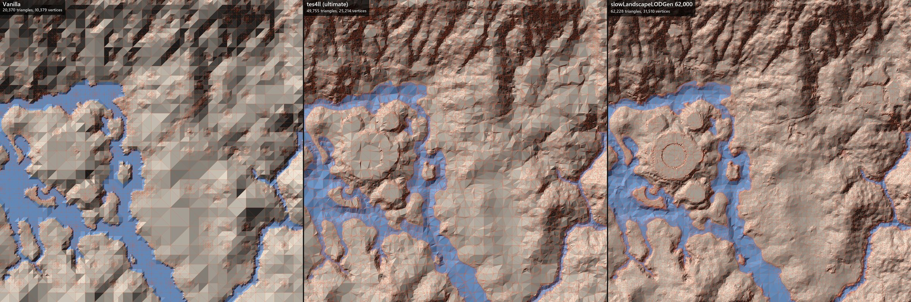

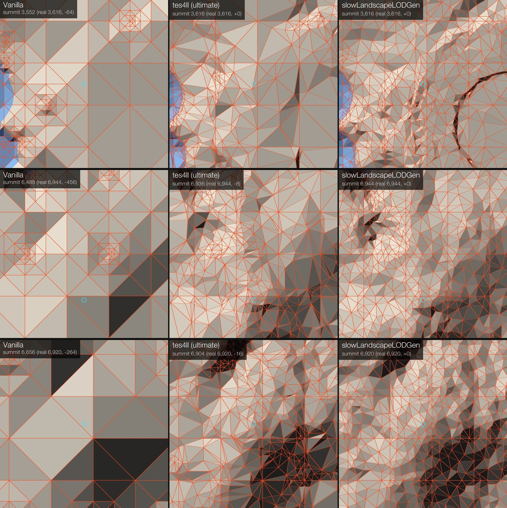

### Color maps
**TES4qLOD** looked up the landscape texture for each texture point, matched it to a pre-cached 4×4 pixel thumbnail of that texture, and painted the corresponding color. Layers were blended either "best-win" (highest opacity wins) or with basic alpha compositing, and the thumbnails lost virtually all texture detail. Basically, it took 4×4 versions of the land textures and made a sort of mosaic out of them, which is why anything that didn't blur neighbouring points together ended up with a terrible blocky look.

**slowLandscapeLODGen** does this instead:

- **Resolution-scaled texture samples.** Landscape textures are resampled to a size that grows with the internal resolution, so higher settings really do show more of the texture's detail.
- **Stochastic tiling.** This deals with the bane of landscape texturing: tiling, which becomes more apparent at higher resolutions and at a distance. Instead of repeating each texture on a regular grid, the whole image is covered by a triangular grid; each grid vertex takes a randomly offset sample of the texture, and the three samples around each pixel are blended with barycentric weights. This breaks up the tiling grid you would otherwise see from a distance. The blend is variance-preserving, so the result stays crisp instead of washing out to the average color.

  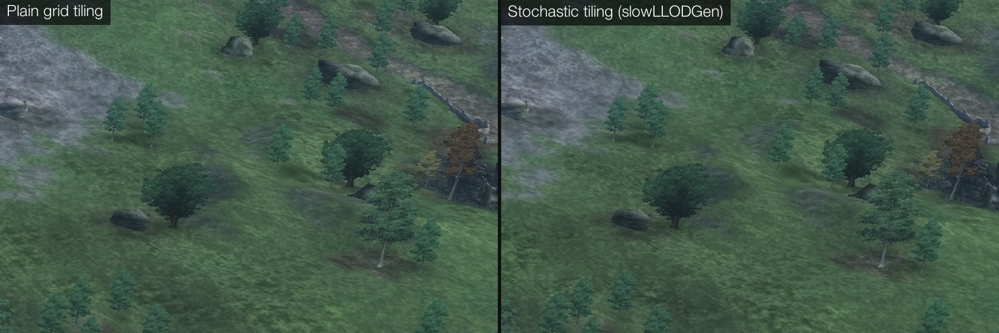
  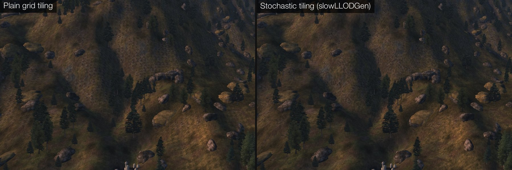
  *Stochastic tiling vs plain grid tiling (color map 8192), in two places. The plain grid shows regular diagonal streaks in the grass and a repeating pattern across the hillside; stochastic tiling breaks them up.*
  [Interactive comparison](https://slowpard.github.io/slowmods-imgcomparisons/slowlandscapelodgen/stochastic-tiling/)
- **9-direction Gaussian blending.** Every LAND point also bleeds into its 8 neighbours, so texture changes fade across cells instead of ending in hard seams (that's what made tes4ll's 4K textures look bad).
- **Vertex colors.** The LAND vertex colors are applied as a multiplicative tint, the same way the game applies them up close.
- **Noise brightness compensation (optional).** The game's LOD shader darkens the color map with a terrain noise texture, and modded noise textures often have a different average brightness, which can show up as a mismatch where the LOD meets the local landscape. This option brightens the color map to compensate.

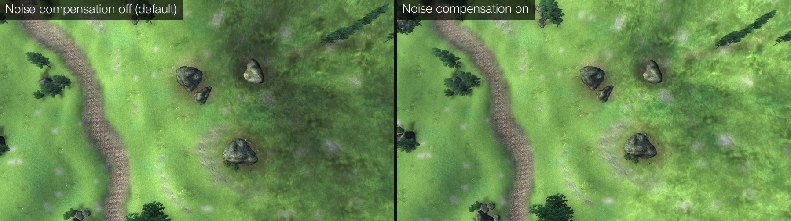

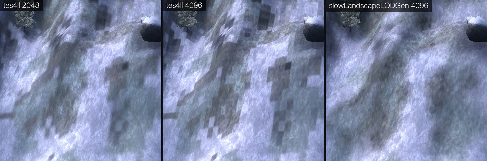
*tes4ll at 2048 and 4096 vs slowLandscapeLODGen at 4096. At 4096, tes4ll's hard-edged texture points turn into a visible block grid.*

### Normal maps
**tes4ll** computed normal maps from derivatives of the heightmap and could optionally tilt the normals based on directional slope analysis ("fake shadows", north-boost).

**slowLandscapeLODGen** builds an actual triangle mesh from the heightmap, computes angle-weighted vertex normals (each face counts in proportion to its angle at the vertex, which is more correct than a plain average) and bakes them into the texture with barycentric interpolation between the vertices. This gives very smooth normals that follow the original curvature of the land, and avoids the rectangular "steps" of tes4ll's derivative-based approach, which can be visible in certain lighting. On top of that:

- **Fake shadows (optional).** The same west/east/north slope idea as tes4ll, applied to the vertex normals before baking. The tool looks up to 32 cells in each direction, stepping finer close by and coarser further away.
- **Noise (optional).** Procedural Perlin noise adds fine surface detail that the heightmap simply does not have.
- **Z-boost.** Exaggerates (or flattens) the relief in the lighting.

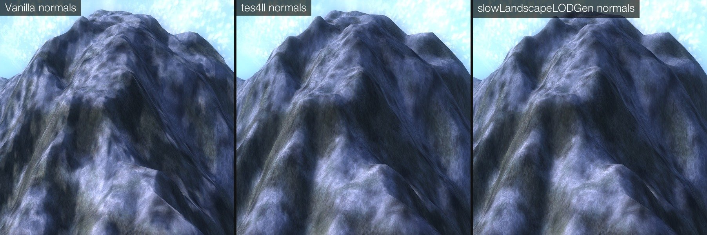
*Normal maps: vanilla, tes4ll and slowLandscapeLODGen, on a snowy mountain peak.*
[Interactive comparison](https://slowpard.github.io/slowmods-imgcomparisons/slowlandscapelodgen/normal-maps/)

## **Settings**

The defaults are a good start; most people only pick worldspaces and maybe change the texture resolution. The window starts from the defaults in `LODGen_config.toml` next to the exe; each setting below gives its key there, in case you want different defaults. The file also holds a few advanced and debugging options, but normally you don't need to open it.

Where a setting has an **Interactive comparison** link, it opens a page where you can drag between screenshots, zoom in, and switch between five scenes.

### Color map

**Resolution**: default 4K; `texture_dimension = 4096` in the `[texture]` section.

Color map size per quad, 512 to 16K. Each step up is 4× the disk space and VRAM (8 MB per quad at 4K, 32 MB at 8K, 128 MB at 16K).

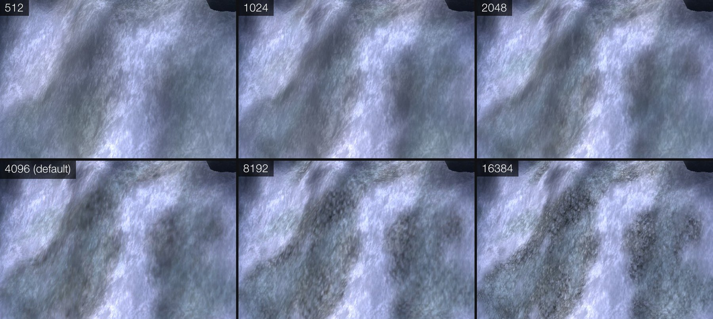
[Interactive comparison](https://slowpard.github.io/slowmods-imgcomparisons/slowlandscapelodgen/color-map-resolution/)

**Render at**: default 4K; `internal_dimension = 4096` in the `[texture]` section.

Working resolution, 2K to 16K, never lower than Resolution. When it is above the output resolution, the map is rendered larger and then downscaled (supersampling), which gives a more detailed texture. 2× the output resolution is recommended.

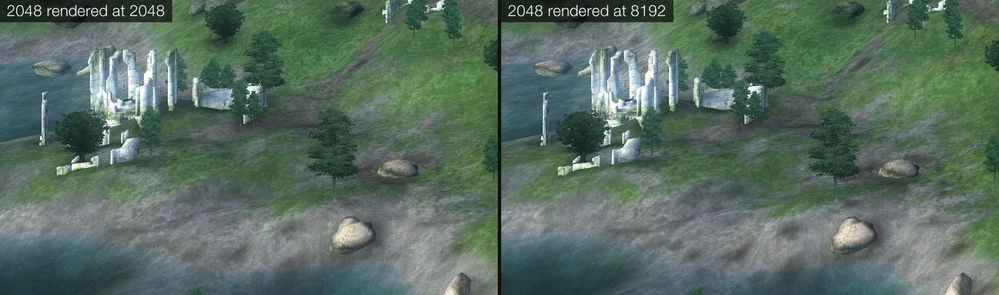
*A 2048 color map rendered at 2048 and at 8192. Rendering larger gives smoother transitions between the grass and dirt patches.*
[Interactive comparison](https://slowpard.github.io/slowmods-imgcomparisons/slowlandscapelodgen/render-at/)

**Blending falloff**: default 2.5; `gauss_blending_falloff = 2.5` in the `[texture]` section.

How much neighbouring texture samples blend into each other. **Lower is smoother and blurrier, higher is sharper and blockier.** Note that the same number works a bit differently at different resolutions.

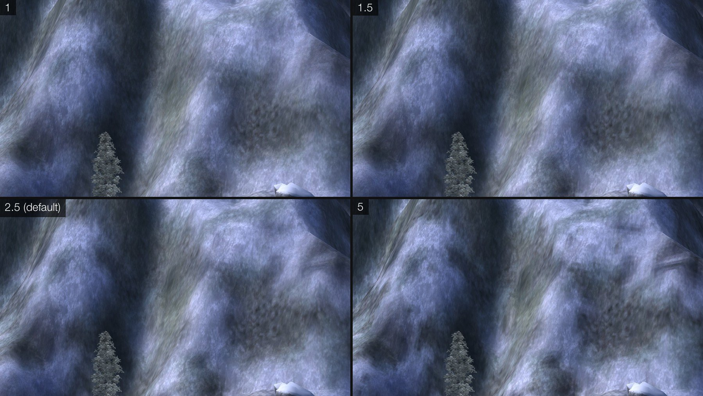
[Interactive comparison](https://slowpard.github.io/slowmods-imgcomparisons/slowlandscapelodgen/blending-falloff/)

**Noise brightness compensation**: default 0.00; `noise_compensation = 0.0` in the `[texture]` section.

The game's LOD shader darkens the color map with a terrain noise texture (by 27% on average with the vanilla noise), so distant LOD looks darker than the same ground nearby. This option measures the installed noise texture and brightens the color map by that amount: 1 = full match, 0 = off (vanilla look). The algorithm avoids clipping in brighter areas. **Note that this makes LOD textures significantly brighter, Darker LOD might be a stylistic choice, so this option is off by default.**

**DXT1 quality**: default 10; `dds_encode_quality = 10` in the `[texture]` section.

DXT compression level, 0-18. The file size is the same; higher is slower and very slightly less blocky, and there's not much reason to go above 10. 14 takes about 2.5 times as long as 10, and 18 about 11 times.

**Ambient occlusion / AO strength**: default off / 1.00; `enabled = false` and `strength = 1.0` in the `[ao]` section.

**Experimental.** Darkens valleys and crevices. Strength: 0 = no effect, 1 = full.

[Interactive comparison](https://slowpard.github.io/slowmods-imgcomparisons/slowlandscapelodgen/ambient-occlusion/)

### Normal map

**Resolution**: default 2K; `texture_dimension = 2048` in the `[normal_map]` section.

Normal map size per quad. The heightmap has 1024 points per quad side, so above 1K there is no new terrain detail, only smoother shading and smaller compression blocks (and some room for detail noise if you use it).

[Interactive comparison](https://slowpard.github.io/slowmods-imgcomparisons/slowlandscapelodgen/normal-maps/)

**Format**: default DXT1; `compression = true` in the `[normal_map]` section (false = uncompressed).

DXT1 is 8× smaller than uncompressed, but its 4×4 compression blocks can be more visible in normal maps than in color maps.

[Interactive comparison](https://slowpard.github.io/slowmods-imgcomparisons/slowlandscapelodgen/normal-map-format/)

**DXT1 quality**: default 14; `dds_encode_quality = 14` in the `[normal_map]` section.

DXT compression level, 0-18. The file size is the same; higher is slower and very slightly less blocky. For normal maps the sweet spot seems to be 14; 18 takes about 4 times as long.

**Z-boost**: default 1.00; `z_boost = 1.0` in the `[normal_map]` section.

Higher makes distant hills and mountains stand out more in the lighting, lower makes them look flatter. 1.0 matches the real terrain; other values look less natural.

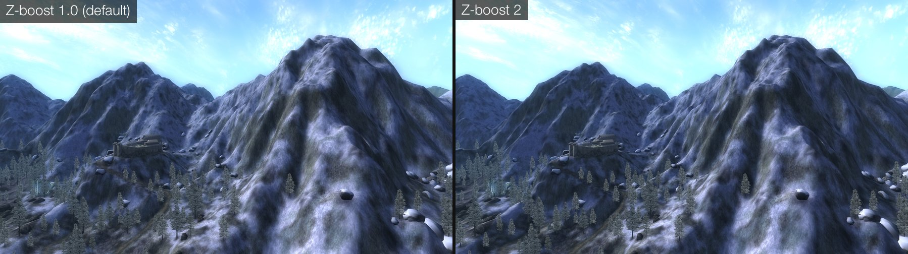
[Interactive comparison](https://slowpard.github.io/slowmods-imgcomparisons/slowlandscapelodgen/z-boost/)

**Fake shadows / Shadow strength**: default off / 1.00; `shadows_enabled = false`, `shadow_strength = 1.0` in the `[normal_map]` section.

Tilts the shading away from tall terrain to the west, east and north, as if it cast shadows, making mountains look more dramatic. Same approach as tes4ll.

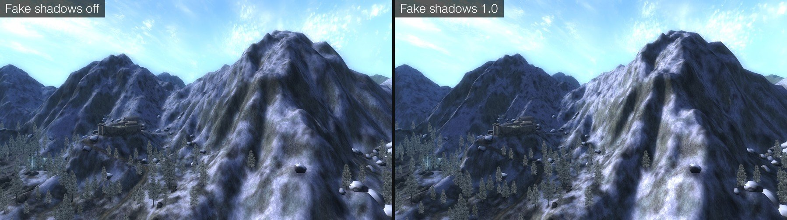
[Interactive comparison](https://slowpard.github.io/slowmods-imgcomparisons/slowlandscapelodgen/fake-shadows/)

**Detail noise**: default off; `noise_enabled = false` in the `[normal_map_noise]` section.

Adds procedural bumps that the heightmap doesn't have.

**Noise intensity**: default 8; `noise_intensity = 8` in the `[normal_map_noise]` section.

Strength of the bumps.

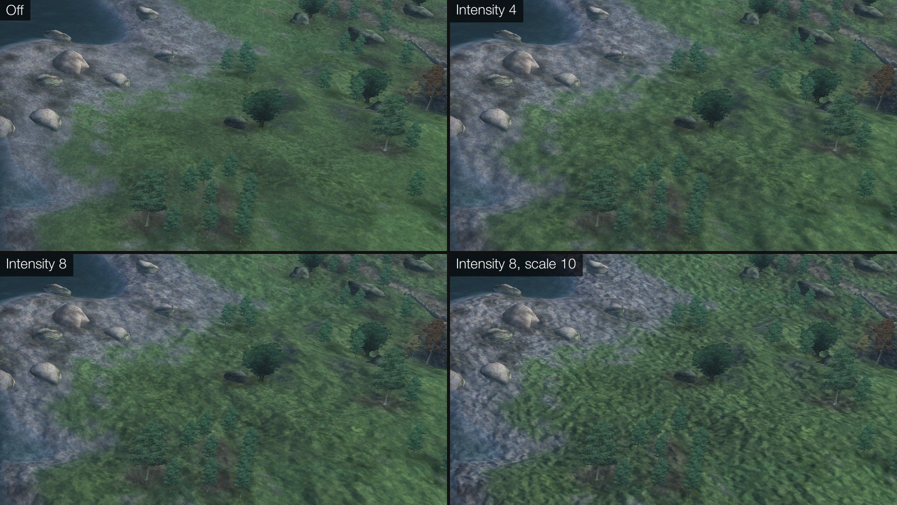
[Interactive comparison](https://slowpard.github.io/slowmods-imgcomparisons/slowlandscapelodgen/detail-noise/)

**Noise scale**: default 20; `noise_scale = 20` in the `[normal_map_noise]` section.

Feature size: higher = larger, coarser features. The noise has a fixed size on the ground, so it needs a big enough normal map (2K at scale 20, 4K at scale 10); on a smaller one it turns into pixel grain.

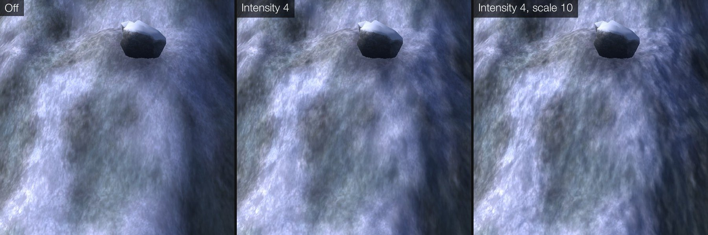
[Interactive comparison of noise on different normal map sizes](https://slowpard.github.io/slowmods-imgcomparisons/slowlandscapelodgen/detail-noise-format/)

### Mesh

**Triangles per quad**: default 62,000; `target_triangles = 62000` in the `[mesh]` section.

Triangle budget per quad, 4,000 to 62,000 (the NIF format tops out at 65,535). The higher the value, the more detailed the mesh.

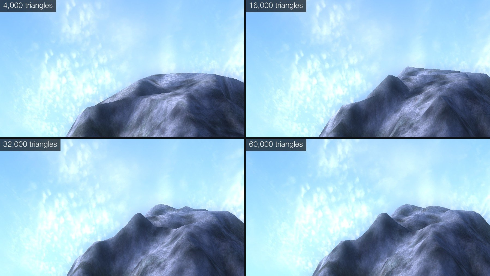
[Interactive comparison](https://slowpard.github.io/slowmods-imgcomparisons/slowlandscapelodgen/mesh-triangles/)

**Threads**: default 8; `threads = 8` in the `[mesh]` section.

Number of quads processed at the same time. Each one needs about 400 MB of RAM.

**Edge UV inset**: default Auto; `uv_clamp = "Auto"` in the `[mesh]` section (or `true` / `false`).

Fixes the annoying line between LOD quads by insetting the UV coordinates at the quad edges. [LOD Seams Be Gone](https://www.nexusmods.com/oblivion/mods/56745) fixes this bug in the engine instead, so in Auto mode slowLandscapeLODGen applies its own fix (which is arguably less optimal) only if LOD Seams Be Gone is not installed.

### Output

**Output folder**: default the game's Data folder; `output_folder` in the `[paths]` section.

Where the files are written. With MO2, **Browse…** to an empty folder in your `mods` folder; **Reset** goes back to the game's Data folder.

**Engine Bug Fixes naming**: default Auto; `use_enginebugfixes_naming_scheme = "Auto"` in the `[general]` section.

Load-order-independent file names for mod-added worldspaces, so their LOD survives load order changes. **Auto** uses them when Engine Bug Fixes' terrain LOD patch is active.

## **FAQ**

**Do I still need tes4ll?**

Nope! slowLandscapeLODGen generates everything tes4ll did for landscape LOD. Object LOD is a different story: that's [slowLODGen](https://github.com/slowpard/slowLODGen)'s job.

**Will higher-quality LOD hurt my FPS?**

There should be no impact on modern systems.
 VRAM .//RAM consis a dconsideration, especially if you don't have any p for high-res textures (4K+)atch,  that disablies mirroring of texture in RAM (OR or ENBOoost).s
**My mod worldspace's LOD disappeared after I changed my load order.**

Install Engine Bug Fixes with the terrain LOD load patch (see Requirements) and regenerate: with it, the LOD files get load-order-independent names.

**The log says "Suspicious triangulation input" or "Merged ... vertices".**

Nothing to worry about. The tool found terrain that could trip up the mesh-building library and handled it, either by fixing it or by building that part more carefully. If the tool actually crashes while building meshes, set `safe_nif_saver = true` in `LODGen_config.toml` and let us know.

**Can I run it on my own Python?**

Yes: Python 3.11 with the packages from `requirements.txt`, then `python slowLandscapeLODGen.py`.

## **Credits**

Thanks to Lightwave (TES4qLOD) and Gruftikus (tes4ll) for setting the bar for Oblivion landscape LOD all these years. slowLandscapeLODGen doesn't use any of their code directly, but it borrows many ideas and approaches from tes4ll, so many thanks to Gruftikus for putting countless hours of work into it.

- **Mesh simplification** follows Garland & Heckbert, "Surface Simplification Using Quadric Error Metrics" (1997).
- **Texture tiling** follows Deliot & Heitz, "Procedural Stochastic Textures by Tiling and Blending" (2019), in a simplified form: we skip the proper histogram matching, as it is very computationally expensive.
- **Triangulation** uses Jonathan Shewchuk's **Triangle** (constrained Delaunay with quality refinement).
- **DDS encoding** uses **quicktex**, a Python wrapper around Rich Geldreich's **RGBCX** BC1/DXT1 encoder (from [bc7enc](https://github.com/richgel999/bc7enc)).
- **NIF files** are written with a patched **PyFFI**.
- **Numba** is used for much of the compute-heavy part of the tool.
- **The GUI** is built with **CustomTkinter**.
